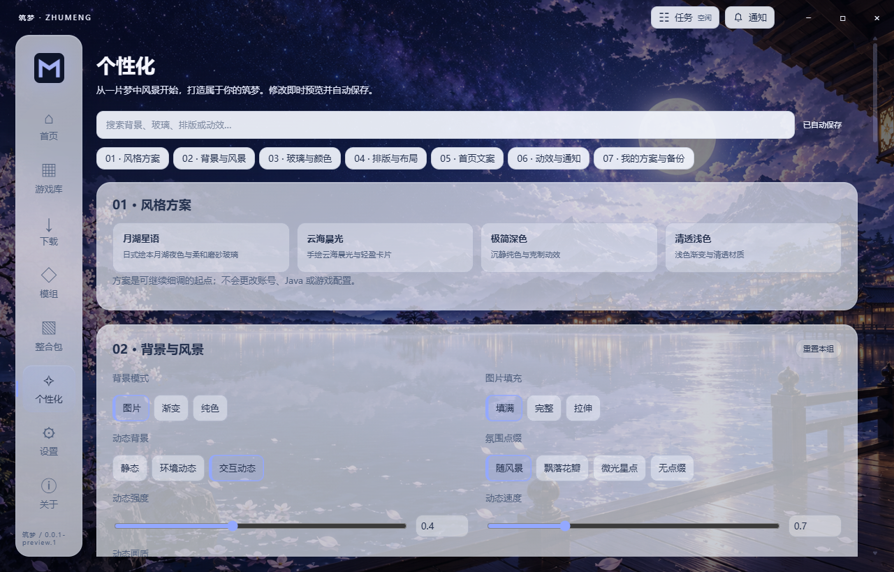

<div align="center">
  
  <h1>筑梦启动器</h1>
  <p>在月湖与星光之间，开启你的 Minecraft 世界。</p>
  <p>日式绘本风景 · 液态玻璃界面 · 独立游戏实例</p>
  <p>
    
    
    
  </p>
  <p><a href="https://github.com/beizilaoshi/Buildingdreams/releases/tag/v0.0.1-preview.1">下载预览版</a> · <a href="https://github.com/beizilaoshi/Buildingdreams/issues">反馈问题</a> · <a href="docs/releases/0.0.1-preview.1.md">更新说明</a></p>
</div>


筑梦启动器是一款 Windows 上的 Minecraft Java 版启动器，由 **[杯艺宣](https://github.com/beizilaoshi)** 开发。把版本安装、资源管理与日常启动放进一扇清透的窗口，也给自己的游戏桌面留一点风景。

### 下载与开始

| 发行文件 | 适合场景 |
| --- | --- |
| [免安装版 · portable.exe](https://github.com/beizilaoshi/Buildingdreams/releases/download/v0.0.1-preview.1/Buildingdreams-0.0.1-preview.1-x64-portable.exe) | 下载后直接运行 |
| [安装版 · nsis.exe](https://github.com/beizilaoshi/Buildingdreams/releases/download/v0.0.1-preview.1/Buildingdreams-0.0.1-preview.1-x64-nsis.exe) | 按向导安装，可选择目录 |
| [SHA256SUMS](https://github.com/beizilaoshi/Buildingdreams/releases/download/v0.0.1-preview.1/SHA256SUMS) | 校验下载文件 |

需要 Windows x64。本版尚未代码签名，Windows 可能提示未知发布者。免安装版默认仍将用户数据保存在 Windows 应用数据目录；它不代表数据随 EXE 移动。需要隔离数据时，可设置 `ZHUMENG_DATA_DIR`。

1. 创建本地身份，或按下文配置微软登录。
2. 在“下载”选择 Minecraft 版本与加载器，确认安装位置和实例隔离选项。
3. 回到首页选择身份与游戏，点击启动。缺少兼容 Java 时，可由启动器自动下载。

### 让启动器成为你的风景

内置月湖、樱夜与云海等绘本场景，配合玻璃材质、柔和光影和开场动画。背景支持区域位移、湖面波纹和鼠标视差的 **2.5D 动态效果**；这是栅格场景动效，并非 Cubism 模型。

49 项外观设置覆盖背景、材质、布局、首页和动效；提供 4 个预设，最多保存 24 个个人方案，并支持导入、导出与分组重置。可调整玻璃透明度、模糊、折射、强调色、字体、卡片间距及动画强度，也可启用减少动态效果。



### 从安装到启动

| 能力 | 当前预览版 |
| --- | --- |
| 游戏安装 | 原版及 Fabric / Quilt / Forge / NeoForge；固定游戏资源根目录与实例隔离选项 |
| 资源浏览 | Modrinth / CurseForge 的模组、整合包、资源包、光影与数据包；中文别名与标签查找 |
| 整合包 | 导入 `.mrpack` 与 CurseForge ZIP，预览后安装；支持 `.mrpack` 导出 |
| Java 管理 | 按版本与加载器选择兼容 Java，按需下载并校验 Temurin，可手动指定 |
| 身份 | 本地身份与通过外部 PCL 完成的微软授权；微软身份支持官方皮肤头像 |
| 启动反馈 | 贪吃蛇等待动画持续到检测到游戏窗口或 PCL 图形初始化标记；可查看启动日志 |
| 任务与通知 | 查看下载进度、取消或重试任务，回看本次页面会话通知 |
| 版本更新 | 启动时检查与手动检查 GitHub Releases，支持预览 / 稳定通道；由用户明确选择下载 |

更新检查不会自动替换或执行程序。Java 自动下载当前面向 Windows x64；部分历史 Java 版本需手动提供。安装包不附带 Minecraft、Java 或 Mod。

### 微软登录与内容来源

微软登录需要 **.NET Framework 4.8**，以及用户自行准备、受支持的外部 **PCL 可执行文件**。在设置中配置 PCL 路径，再按登录界面指引完成浏览器授权。当前登录由本机桥接程序调用 PCL 授权能力，单独填写微软客户端 ID 不能替代这一依赖。PCL 需另行从其官方渠道取得并遵守其许可。

账号凭据由 Windows DPAPI / Electron safeStorage 加密保存。请勿分享账号库、用户数据目录或授权代码。本地身份适用于离线与本地场景，不能代替游戏所有权或正版服务器授权。真实微软交互授权、账号权限和完整游戏运行仍需用户在自己的环境中验证。

CurseForge 搜索需要用户自己的合法 API key，可仅本次使用或加密保存。遇到作者限制分发、无下载链接或缺少受支持校验和的文件，启动器会提供官方页面或要求手动补齐，不绕过限制。导出整合包前，请检查本地覆盖文件的许可与隐私；默认不勾选这些文件。

### 开发与构建

使用 Windows x64、**Node.js 24+** 和 npm。应用基于 Electron 45、TypeScript 与 Vite；安装位置锁使用 `node:sqlite`。原生登录桥接还需要 Visual Studio / Build Tools 的 **MSBuild、.NET Framework 4.8 开发工具与目标包**；仅安装 .NET SDK 不足以运行现有构建脚本。

```powershell
npm ci
powershell -ExecutionPolicy Bypass -File tools/pcl-bridge/build.ps1
npm run dev
```

```powershell
npm run typecheck
npm test
npm run build
npm run verify          # 包括真实 Electron UI 验证
npm run dist            # 构建 Windows portable / NSIS
npm run verify:package  # 检查发行资源、许可与校验和
```

运行微软登录仍需另行配置受支持的 PCL。联网与实际游戏验证依赖网络、Java 和对应账号权限；不要将自己的账号数据或验证产物加入发行包。

### 致谢与许可

本项目采用 Electron / TypeScript 架构，参考并选择性移植 PCL 的部分行为与资源；**并未实现 PCL 全部功能**。PCL 授权桥接、中文名称快照、图标和美术的许可各自独立，不应将整个项目或这些资源统一视为 MIT。

感谢 PCL、XMCL、Electron、Modrinth、CurseForge 及相关开源项目。软件依赖与素材的权利归各自作者所有，详见 [第三方说明](THIRD-PARTY-NOTICES.md)、[素材来源](ASSET-SOURCES.md) 和 [PCL 来源记录](docs/pcl-source-references.md)。Minecraft 商标与游戏权利归其权利人；本项目不提供游戏授权。

发现问题时，欢迎在 [Issues](https://github.com/beizilaoshi/Buildingdreams/issues) 附上复现步骤、系统版本与脱敏日志。请勿上传账号库、令牌或私人路径。
